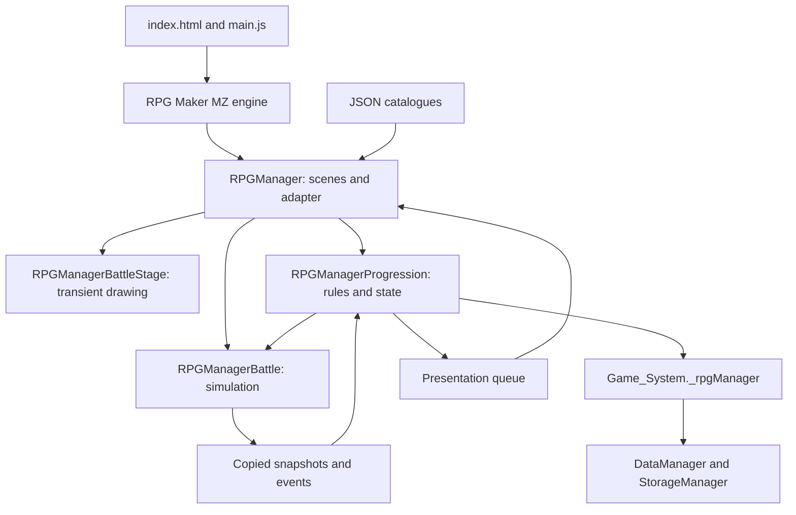

> **Historical architecture reference.** The dated sections below contain superseded schema, roster, level-cap and combat rules. For the October 17, 2026 current implementation, use the [complete game handoff](../context/Teamfight_Manager_Post_Sprint_Handoff.md) and [exact runtime snapshot](Handoff_Runtime_Snapshot_20261017.json). Current source and merged runtime data take precedence.

# RPG Manager Architecture

**Current Focus Companion follow-up:** schema **23**. The expedition state remains the single focus clock; `js/focus_companion.js` is a read-only projection and isolated optional NW.js window controller loaded by `index.html`, not another simulation plugin. Persisted preferences/position, authored difficulty, between-battle retreat, deliberate early end and accurate recaps are documented in [Focus_Companion_Sprint.md](Focus_Companion_Sprint.md). Six classes/cap 4/class Armor/critical Attack and the four plugin layers remain. The previous readability supplement and economy/art audit are historical foundations; older schema examples below are not current requirements.

Latest October 14 presentation layer: `RPGManagerBattleStage.js`, registered after Progression and before RPGManager. It is independent of simulation/domain mutation and exports geometry, snapshot display and transient start/update/finish animation helpers. Current delivery: `Visual_Battle_Sprint.md`; asset provenance: `Visual_Battle_Art_Prompts.md`.

Original code review: October 3, 2026. Pomodoro active-slot/countdown sprint reviewed October 14, 2026. English translation: October 13, 2026. This document describes the code and data present in the project at the recorded review. Historical notes in `context/archive/` do not define current behavior. The original architecture review remains dated October 3. The October 13 cozy fantasy UI implementation and its new verification are documented separately in `docs/Cozy_Fantasy_Visual_System.md` and the current handoff.

## 1. Overview

RPG Manager is an adventurer management game built on RPG Maker MZ. The player equips three active members, assigns camp jobs, and selects an authored contract to dispatch all three automatically. New games start with Ada, Bram and Cora; death or confirmed dismissal creates vacancies that Tavern fills for free. Combat is simulated using custom rules and then presented visually; animations do not decide outcomes.

The application runs in RPG Maker's NW.js desktop runtime or in a browser serving resources over HTTP. The game architecture has no business server, remote database, or multiplayer service. Catalogues are JSON files, and games are saved through MZ's storage system.

The main separation covers three responsibilities:

1. **Simulation:** resolve combat and produce reproducible events.
2. **Domain:** manage persistent state, expeditions, resources, and their consequences.
3. **Interface and integration:** load content, connect the domain to MZ, manage scenes, and present events.

## 2. Technologies and execution

| Component | Role in the project |
|---|---|
| RPG Maker MZ 1.10.0 | Engine, scenes, windows, input, audio, assets, and saving. Version declared in `js/rmmz_core.js`. |
| JavaScript | Engine and custom plugin code, without a compilation step. |
| NW.js | Desktop container; `package.json` declares `index.html` as its entry point and an 816 × 624 window. |
| Bundled PixiJS 5.3.12 | Graphics infrastructure used by MZ; this is not a standalone PixiJS v8 application. |
| Effekseer and WebAssembly | Effects runtime initialized at startup. |
| pako and localforage | Engine compression and storage. |
| Node.js | Rule tests and syntax checks. |
| Python and Playwright | Catalogue tools, backups, and browser tests. |

`package.json` is the NW.js configuration: it contains no npm scripts, declared dependencies, or frontend build pipeline. Runtime libraries are distributed in `js/libs/`.

## 3. Repository structure

| Path | Responsibility |
|---|---|
| `game.rmmzproject` | Opens the project in the RPG Maker MZ editor. |
| `index.html`, `css/game.css` | Entry page and web container styling. |
| `js/main.js` | Initial loader for the engine, libraries, and plugins. |
| `js/rmmz_*.js` | Distributed engine code: core, managers, objects, scenes, sprites, and windows. |
| `js/plugins.js` | Active plugin registry and load order. |
| `js/plugins/RPGManagerBattle.js` | Combat simulator and rules. |
| `js/plugins/RPGManagerProgression.js` | Progression rules and state transactions. |
| `js/plugins/RPGManagerBattleStage.js` | Presentation-only embedded art, animation, effects and cleanup. |
| `js/plugins/RPGManager.js` | MZ adapter, navigation, and game presentation. |
| `data/` | Standard MZ databases and custom catalogues. |
| `img/`, `audio/`, `effects/`, `fonts/`, `movies/`, `icon/` | Visual, audio, and multimedia assets. |
| `save/` | Local save files, depending on engine storage. |
| `scripts/` | Content synchronization and project backups. |
| `tests/` | Automated tests, fixtures, and manual acceptance guides. |
| `context/` | Editable catalogue, decisions, and current handoff documentation. |
| `context/archive/` | Documentation from earlier stages. |
| `backups/` | ZIP backups and backup documentation. |
| `docs/` | Technical documentation, including this document. |

Other plugins, such as `AltMenuScreen`, `AltSaveScreen`, `ButtonPicture`, and `TextPicture`, exist as files but are not enabled in the current registry.

## 4. Startup and MZ integration

`index.html` loads `js/main.js`. The `Main` class checks that it can read files through XHR, installs NW.js shutdown handling, loads libraries and engine files in order, and calls `PluginManager.setup($plugins)`. After initializing Effekseer, it starts `Scene_Boot` through `SceneManager`.

Active plugins must load in this order:

```text
RPGManagerBattle → RPGManagerProgression → RPGManager
```

The first three expose global APIs and CommonJS exports for Node. RPGManager consumes those APIs and extends engine methods. The files use immediately invoked functions to encapsulate their implementations; there are no ES modules or dependency injection container.

`RPGManager.js` retains references to original methods and wraps them, including `DataManager.loadDatabase`, `DataManager.isDatabaseLoaded`, `Scene_Boot.onDatabaseLoaded`, `Game_System.initialize`, and `Scene_Base.update`. It also adapts title options, loading, and some audio functions. This technique allows MZ reuse but makes load order and plugin compatibility important contracts.

The standard database still loads. The plugin adds eight custom files and waits for them to become available. In `Scene_Boot.onDatabaseLoaded`, it composes the final catalogue, configures classes and dialogue, validates quests, and preloads portraits.

## 5. Layers and dependencies



### Simulation: `RPGManagerBattle.js`

Its main API is `RPGManagerBattle.Battle`. It receives teams and options such as seed, strategy, and action limit. It copies input data, so damage does not directly modify the persistent roster. `step()` advances the simulation; `snapshot()` and `events` return copies of state and the log.

It includes initiative, target selection, strategies, basic attacks, special abilities, dodge, defenses, and d20 checks. Fighters have keys distinguishing their side, even when opposing teams contain identical IDs. Outcomes are victory, defeat, or draw from the player's perspective; an action limit prevents endless combat.

With identical inputs and seed, the simulation is reproducible. This guarantee should not be extended to the entire application: initial creation and other processes may use randomness or dates. This module does not grant rewards, save games, or draw animations.

### Domain: `RPGManagerProgression.js`

It exposes functions operating on state objects, such as `createState`, `upgradeState`, `prepareTeam`, `dispatchQuest`, `tickRealtimeExpedition`, `completeReturn`, `accrueCampJobs`, `equipSlot`, `resultSnapshot` and `dismissQuestResults`. Legacy repair mutations reject calls without changing state. It centralizes rules that must also hold when calls do not originate from the usual screen.

It manages characters, levels, XP, identity, wounds, deaths, Bonds, shared inventory, equipment, resources, rituals, jobs, quests and settlement. Legacy recruitment timers are inert; the existing candidate catalogue supplies free vacancy hires. It produces and normalizes presentation records but does not depend on the DOM or draw windows. Some functions access global configuration or `Date.now()`; it is therefore a rules layer decoupled from the interface, rather than a completely side-effect-free set of functions.

The simulator prepares transient results; this layer decides how to incorporate them into the campaign. Protection against duplicate settlement and restrictions on absent characters belong here.

### October 14 Next Playtest additions

Schema stays 21. Optional `startingRosterPending` is set only by New Game; established saves retain their active slots. `eventCues` and per-trip `eventCueKeys` record and consume battle-start/end and random-event cues independently of rendering; load suppresses pending delivery. Alerts applies to all cues. Optional owned audio buffers and `managerArt` bitmaps stay outside MZ's fatal audio/image caches, retaining fallback glyphs/text.

Potion restores 2 HP; Medkit requires/treats Wounded and restores 1 HP. Both cap at max and preserve permanent injuries; IDs/prices/reward probabilities remain. Catalogue-owned optional `expedition` dialogue pools are validated/synced through the existing Markdown script; saved flavor counters rotate speakers/variants. Flavor is derived from real events and never alters outcomes or time. Complete delivery, verification and native limitations: `Next_Playtest_Sprint.md`.

### Illustrated travel and under-character counters ? October 14

`RPGManagerBattleStage.TravelStage` owns cached mirrored woodland/cavern panoramas, foreground parallax and walking poses. Its frame delta is consumed only while active/visible, excludes suspended gaps, and reverses continuously for return. `travelMembers` reads current NPC HP, remaining equipment Armor and Ward without normalization/mutation, falling back to prepared legacy data. Nameplates put all three values beneath each traveler. The battle geometry also reserves under-party ribbons using event-snapshot stats; narrow lanes stack the icon/counts. Existing fixed status rails remain.

UI owns/suspends/destroys the transient travel renderer, retaining the procedural exception fallback with counters. Decorative walking restarts on load; quest phase/time, state and schema 21 remain unchanged. Reused artwork/provenance and exact validation: `Illustrated_Travel_Update.md`.

### Embedded visual stage: `RPGManagerBattleStage.js`

`RPGManager.js` supplies optional image loading, Bitmap/drawing helpers and quest lookup to a window-owned Stage. The helper lays out fixed status rails and a clipped center lane, chooses cached illustrated environments/custom creature source rectangles or matching stock side-view frames, and draws resolved-event poses/effects. It never advances the queue or clock, plays sound, or invokes the simulator. Mid-action resume uses saved `presentationDurationMs`/`presentationHoldMs`; renderer state is transient and destroyed with its window. Travel/results/Skip clear effects. UI catches a visual exception and retains the legacy renderer for that event.

Schema remains 21. Copied presentation events optionally carry `attackKind`, `survived`, `permanentDeath`; copied presentation fighters retain `presentationLifeState` after a displayed fall/save. Unknown legacy fate stays DOWN. These additions only clarify display; authoritative NPC state, event order, consequences, payouts and timing remain unchanged. Active sessions/results use a compact context strip to gain 34 vertical pixels without hiding the clock or controls. No normal-play Pace menu was restored.

### Interface and adapter: `RPGManager.js`

It consumes content and rules, and exposes `window.RPGManager` as a facade for state access, battle creation, restoration, and utilities. It implements windows derived from `Window_Base`, `Window_Command`, and other MZ classes, along with scenes derived from `Scene_RPGBase`.

`Scene_RPGHome` displays the animated woodland campsite on the left and a compact three-slot HP/condition roster on the right when idle. `Window_RPGCampsite` retains walking, Workshop/Study/Rest destinations and job interaction props; `Window_RPGCampRoster` replaces the former Life at Camp summary. Active expeditions use the full main area by default; `layoutExpedition` and an arrow/Shift toggle open the roster alongside without covering the countdown. Results automatically open the roster, show saved portraits and use Finish to dismiss once to Home. Camp Jobs retains the woodland/job-prop view. Quest Board dispatches all three filled active slots directly without member/leader selection or party review. Remaining actions open Guild Hall, Quest Board, Armory, Tavern, Altar, Graveyard, Camp Jobs, Alerts, Save and Title. Repair, Pace, Campaign and Bathhouse are removed. Tavern only fills vacancies for zero Gold; member dismissal requires confirmation at camp. DEBUG is disabled in normal play. Camp job cues are drawn by `CozyUI.jobCue`; `Window_RPGExpeditionPanel.drawResults` displays saved results with input-driven pagination.

The file retains combat, travel, and decision scenes and routes from earlier stages. Their presence does not mean they belong to the current autonomous flow: current expeditions display combat in Home's compact panel. Report/History are no longer Home commands, although their data is retained.

The October 13 UI pass adds a shared cozy fantasy visual system, an optional illustrated camp with procedural fallback, framed portraits, parchment contracts, responsive Home panels and restrained display-only battle motion. These additions remain inside `RPGManager.js`; the simulation/domain responsibilities and schema 21 are preserved.

## 6. Content and data composition

| File | Use |
|---|---|
| `RPGManagerRoster.json` | Editable character template; not a save's mutable roster. |
| `RPGManagerEnemyTeam.json` | Reference enemy team and compatibility data. |
| `RPGManagerClasses.json` | Classes, statistics, and abilities. |
| `RPGManagerDialogue.json` | Dialogue and identity content. |
| `RPGManagerQuests.json` | Enemies, economy, and base quest/encounter configuration. |
| `RPGManagerStage3.json` | Current catalogue of 18 contracts and automatic travel events. |
| `RPGManagerPresentation.json` | Presentation importance, colors, timing, and dialogue. |
| `RPGManagerUI.json` | Custom interface configuration. |

At startup, `RPGManagerQuests.quests` is replaced with quests from `RPGManagerStage3`, its `automaticEvents` are incorporated, and presentation configuration is added. The entire base file is not replaced: its enemies and other parameters remain part of the effective content.

The editable source for classes and dialogue is `context/Adventurer_Classes_and_Dialogue.md`. `scripts/sync_adventurer_catalogue.py` extracts JSON blocks, rejects duplicate keys, runs the progression validator, and checks or writes the two corresponding JSON files and generated tables. Changing only a generated file can leave the catalogue inconsistent.

Standard files such as `Actors.json`, `System.json`, `Map001.json`, `Items.json`, and `Armors.json` remain part of the MZ database. The manager's custom inventory and rules should not automatically be confused with the standard `$gameParty` system.

## 7. State model

The source of truth for a game is `$gameSystem._rpgManager`, created when `Game_System` initializes. The current schema is **21**. Global `$dataRPGManager*` catalogues contain definitions, while save state contains their copies and changes made during play.

The main state groups include:

- Persistent roster with IDs, class, HP, level, XP, condition, identity, and career.
- Gold/Arcana resources, shared inventory, quest selection, and campaign progress.
- Three `activeSlots` IDs/null vacancies; `teams.A` and `trips.A` represent the automatic full active party. The first filled slot leads; existing in-quest succession remains.
- Four equipment slots: Head, Body, Off-hand and Accessory, with condition. Returned slotted gear retains Armor in optional `equipmentConditionStock` queues; transfer to a replacement does not repair it.
- Job assignments and accumulated fractional time per character.
- Active trip, milestones, outcomes, finds, visual queue, and fighter snapshot.
- Stable `questResults`/`report.results`, legacy replay, archive/history and once-only settlement records; `completionCue`/`lastCompletionAlertId` prevent repeated alerts and `completionAlerts` saves mute preference. Pace normalizes to Standard.

A New Game first uses `beginStartingRoster` / `Scene_RPGStartingRoster` to choose exactly three of ten authored candidates. `confirmStartingRoster` validates atomically and fills exactly three active slots; existing saves bypass setup. Unchosen candidates remain separate from active/archive records. Tavern preserves/top-ups at least five valid options and allows browse when full. Every new expedition requires all three slots filled with living available members. Death clears a slot and preserves the Graveyard record; camp-only confirmed dismissal preserves a living dismissed/retired record outside the Graveyard. Tavern hires reuse the existing candidate catalogue and fill vacancies for zero Gold, without exceeding three active members or waiting for an hourly refresh. Old overflow stays retired; legacy active parties finish with their original members. Level cap 6 and low class-dependent HP remain.

Healthy/Wounded/Dead conditions, permanent wounds, and reanimated status remain on the same persistent character. The Graveyard reads those records. Equipment and service operations reject dead or absent characters; repair mutations reject every call without charging; this validation exists in the domain as well as the UI.

## 8. Expedition flow and clock

1. The player selects a contract, immediately dispatching all three active slots. The board groups durations into Short (1–3 minutes), Medium (5–10), and Long (15).
2. `dispatchQuest` validates availability and restrictions, applies the duration authored in the catalogue, and fixes the departure plan. An external duration argument cannot override it.
3. The trip is stored in `trips.A`; its members are excluded from jobs and incompatible camp operations.
4. The scene loop supplies deltas to `tickRealtimeExpedition`. Travel, event, combat, and return milestones resolve automatically. Contracts may have no combat, optional combat, or required combat.
5. The domain prepares fighters, runs the simulation, and applies consequences before building presentation. A visual builder error must not replace an already resolved outcome.
6. When time expires, `completeReturn` settles rewards and progress once and releases the trip. It then stores a settled `questResults` snapshot and immediately displays results, independently of unfinished visual queues. Dismissing results clears the retained replay without settlement.

Missions and camp jobs use a monotonic process-session clock, synchronized by an independent one-second interval and focus/visibility/frame/save hooks. They continue while minimized or unfocused. Missed background ticks are consumed through bounded five-second simulation/production steps. Loading resets runtime anchors, so closed-process time does not advance missions or produce jobs. Legacy hourly recruitment timers remain compatible but do not gate free replacement hires. Candidate pools replenish on demand when exhausted; there is no roster expansion. Save before closing to preserve campaign state.

Visual playback remains foreground-only and preserves unseen events while background missions finish. The independent clock interval also refreshes the visible Home timer bitmap/header when MZ focus-pauses scene updates, and requests a guarded render without processing input or a second simulation delta. Hidden documents skip paint; focus/visibility restoration repaints immediately. The 40 px MM:SS stays fixed throughout running phases and at 00:00 / Complete on results. Normal play uses automatic Standard presentation; legacy speed helpers remain display-only. This corrected session timing was implemented October 13 after the user clarified that closing the game must pause its clocks.

Workshop (stored as `work`) produces one Gold per minute per member; Study one Arcana every five minutes; Rest restores HP after one minute; Idle produces nothing. Job fractions persist, pause on reassignment or expedition departure, and continue while minimized. A production version marker prevents old telemetry becoming retroactive rewards.

Recall requires confirmation, cancels completion rewards and XP, preserves already resolved consequences, and recognizes only finds already acquired. Hidden development helpers can advance to milestones or finish through the same expedition helpers without advancing camp production.

## 9. Separation of combat and presentation

After the dodge check, damage follows Ward → Armor → HP with overflow. Formation, enemy intelligence, abilities, and defense rules are evaluated in the simulation. The domain incorporates wounds, death, equipment deterioration, and other persistent effects.

Presentation uses copies of initial fighters and structured events with attacker/target keys, outcomes, HP/defenses, text, importance, and hold times. The interface presents approaches, target lines, dodges, impacts, fallen fighters, portraits, and boss emphasis without rerolling dice.

Standard, Reduced, and Skip change only visual pacing. They do not affect the quest clock, damage, or rewards. Normal play uses Standard automatically and ignores stored pace preferences. The complete queue can survive saving, but settled results take priority; displaying/dismissing results never grants extra rewards. Outcome captions resume travel immediately and the accumulated road offset reverses on return.

## 10. Persistence and migrations

`DataManager.makeSaveContents` includes `Game_System`, so `_rpgManager` is saved inside MZ's normal format without a custom backend. `StorageManager` serializes with `JsonEx`, compresses with pako, and chooses between local files in NW.js and browser storage through localforage.

On load, `restoreManagerSave` calls `upgradeState`, validates quest selection, clears transient visual state, resets the camp/playback clock, and starts a fresh mission session baseline without consuming closed time. Normalization preserves zero remaining time, partial balances, and valid structured fields, while discarding malformed visual entries. Migrations adapt levels, HP, inventory, legacy slots, and party selections, preserving characters and history where possible.

Supported full `activeQuest` records with prepared teams promote intact into A during upgrade. Unsupported incomplete manually saved records remain in `legacyInterruptedQuest` while their existing recovery route grants no rewards or costs. Stale already-settled active trips restore saved results without another award. This differs from the current expedition in `trips.A`, which resumes its saved remaining time with a fresh process-session baseline, retaining unseen battle playback. Continue tries the most recent save; Load lets the player choose another. Loading errors are shown to the user. Saving also has deletion controls integrated with `StorageManager`.

Without saved slots, migration prefers eligible living/non-dismissed/non-retired starters, then eligible stored legacy records, up to three. Existing vacancies remain empty; dead/dismissed/duplicate/unknown slot IDs become null. Non-selected records receive `retired: true`; they cannot join new sessions or produce camp jobs. Their gear returns to shared stock once after they cease being away, marked by `focusGearReturned`, with remaining Armor preserved in shared stock. Activating a member resets that return marker for their future equipment. Legacy B expeditions move intact into A; if both exist, B is deferred until A results are dismissed. No active trip, settlement history or consequence is discarded. Schema remains 21 with optional slot, condition-stock, snapshot and alert fields. Settlement creates one cue; the runtime records it before optional chime playback. The alert owns its buffer outside MZ's fatal audio cache and disposes errors/timeouts. Muted cues are consumed, and loaded completed results do not notify again. Minted results store totals at return, post-settlement member condition/defenses, aggregated item quantities and level-up flags, so later Rest or purchases cannot change the result display.

## 11. Errors and compatibility

Startup reports inaccessible resources or library failures. Validators detect duplicate IDs, invalid statistics, missing enemy references, and incomplete contracts. Domain operations return results and messages that scenes present to the player.

Expeditions include recovery for simulation failures, allowing return to be reached with a safe snapshot when appropriate. Presentation errors are handled separately to preserve authoritative consequences. The interface provides recovery to Home after runtime failures.

MZ's bundled NW.js runtime imposes compatibility limits: use of `Array.prototype.at`, which failed there, has already been removed. Testing in modern Chromium does not guarantee compatibility with every NW.js version; preserve contracts covered by recovery tests.

## 12. Validation and tools

JavaScript tests use `node:test` and `node:assert`, import the two rules APIs, and use real JSON or fixtures. Some verify UI wiring by reading code or using simulated environments. Python smoke tests start a local HTTP server and automate Chromium with isolated storage, exercising real windows.

The current guide is `tests/Post_Sprint_Fixes_Testing.md`. Its acceptance command is:

```powershell
node --test --test-isolation=none tests/post_sprint_fixes.test.js tests/stage1_camp_home.test.js tests/stage2_realtime_loop.test.js tests/stage3_catalogue.test.js tests/stage4_realtime_presentation.test.js tests/stage5_equipment_repair.test.js tests/recoverable_errors.test.js tests/item_persistence.test.js tests/polish_tuning.test.js tests/small_roster_rework.test.js tests/death_stabilization.test.js tests/complete_battle_sequence.test.js tests/quest_window_polish.test.js tests/mission_background_clock.test.js tests/pomodoro_focus.test.js tests/pomodoro_sprint.test.js
```

Additional checks:

```powershell
node --check js/plugins/RPGManagerBattle.js
node --check js/plugins/RPGManagerProgression.js
node --check js/plugins/RPGManager.js
python scripts/sync_adventurer_catalogue.py --check
python tests/post_sprint_smoke.py
```

The October 14 focused selection passes 107/107 with no failures or skips. Earlier 69/74/77/82/95 counts are dated historical baselines. Updated browser checks cover both resolutions, settled results and save/load, boss playback, camp production, optional-art fallback, and background/closed-time clocks. Historical wildcard fixtures still have obsolete assumptions and are not a current acceptance suite. Native MZ/NW.js visual review remains pending; see `docs/Pomodoro_Focus_Sprint.md`.

`scripts/backup_project.py` creates a complete ZIP excluding earlier backups, avoids overwriting, and verifies integrity and file changes during capture. It does not replace testing or constitute a deployment system.

## 13. Guidelines for extending the project

New rules and transactions should live in progression or combat according to their responsibility. Scenes should consume results and messages, and presentation should continue using copies without modifying resolved outcomes. New quests need valid references and an authored duration; classes and dialogue must stay synchronized with their Markdown catalogue.

Changing the persistent format requires reviewing `upgradeState` and its fixtures. Changing rewards or settlement requires preserving inventory and once-only awards; repair remains disabled. Changing animations requires checking that Standard/Reduced/Skip retain identical consequences.

The strongest coupling is in the interface file, MZ globals, and prototype extensions. Separating future visual components may simplify maintenance, but must preserve plugin order, integration points, and existing migrations.

## 14. Sources for this description

The recorded review is based on `index.html`, `package.json`, `js/main.js`, `js/plugins.js`, the four custom plugins, MZ managers, tooling scripts, and current tests. Decisions and current behavior were cross-referenced against `context/README.md`, the opening section of `context/Teamfight_Manager_Post_Sprint_Handoff.md`, and `tests/Post_Sprint_Fixes_Testing.md`. Where historical notes contradict the current flow, code and the current handoff take precedence.

The reporting endpoint mentioned in the original documentation task was an external destination requested for that task; it is not a game runtime dependency.
